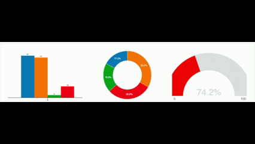

  
  

## 
Привет, меня зовут Надежда! 👋

### 🛠️ Языки и инструменты:

### :man_technologist: Обо мне:
####  :man_technologist: Я Аналитик 
####  📊 Мне нравится весь процесс решения бизнес-задач с использованием данных, а также поиск нестандартных подходов и их применение для улучшения бизнеса.

 #### 📫Как связаться со мной: <a href=""></a>

### Мои достижения
:busts_in_silhouette: Участие в Хакатоне от Островка в треке О!дин запрос (октябрь 2026) (__[Сертификат](https://github.com/Nadezhda2024/Nadezhda2024/blob/main/certificate_individual.png)__)\
:mortar_board: Стажировка в компании Aspex 4 недели (март 2026) в роли BI-аналитика (__[Сертификат](https://github.com/Nadezhda2024/-_Aspex/blob/main/IMG_20260327_132650_283.jpg)__)\
:3rd_place_medal: Решение призового кейса: Заняла **3 место** в конкурсе Fastboard (ноябрь 2025) от компании разработчика Win Solutions (__[Призовое место](https://github.com/Nadezhda2024/Nadezhda2024/blob/main/photo_2025-11-27_19-09-38.jpg)__)
  
- :bar_chart: Занимаюсь аналитикой данных 📈
- :raised_hands: Готова к сотрудничеству 🤝
- :point_down: Мои проекты 👇:
  
 |Название проекта| Описание проекта| Стек|
|----------------|-----------------|-----|
|new-bi-project (__[ссылка на проект](https://github.com/Nadezhda2024/new-bi-project)__)| Репозиторий содержит рабочие материалы, Jupyter-блокноты и первые скрипты для исследования API маркетплейса Wildberries и проектирования локального хранилища данных на базе СУБД PostgreSQL.|Python (библиотеки requests, psycopg2, dotenv, aiohttp), Jupyter Notebook, VS Code, PostgreSQL 18.4, DBeaver, Git / GitHub|
|tg-analyst-userbot (__[ссылка на проект](https://github.com/Nadezhda2024/tg-analyst-userbot/tree/main)__)|Асинхронный Telegram userbot для подготовки кратких отчётов по истории чата. Поддерживаются два текстовых режима: локальная Ollama и облачная Yandex AI Studio.| Python, Jupyter Notebook, Ollama, Qwen, Yandex AI Studio, Git / GitHub|
|travel-agent-analytics  (__[ссылка на проект](https://github.com/Nadezhda2024/travel-agent-analytics)__)| Проектирование архитектуры и API-контрактов для AI-агента путешествий в рамках хакатона Ostrovok 2026. Детерминированный конечный автомат поверх LLM. |Visual Studio Code, Drawio, Google Gemini|
|Стажировка BI-аналитик в ASPEX (__[ссылка на проект](https://github.com/Nadezhda2024/-_Aspex)__) | В составе кросс-функциональной команды (Project Manager, Business Analyst, BI-аналитик), мы провели Discovery компании, выявили ключевые бизнес-проблемы и предложили решение в формате дашбордов. Ответственна за прототипирование дашбордов: определяла метрики, согласовывала их с командой и создавала финальные прототипы на этапе Delivery.|Miro|
|Конкурс (__[ссылка на проект](https://github.com/Nadezhda2024/participation-in-the-competition-Fastboard)__) | Задание конкурса: проанализировать данные, создать понятный и красивый дашборд на свой вкус, используя конструктор дашбордов.|BI система FastBoard, ClickHouse, Figma|
|Дашборд анализа продаж для маркетплейса Wildberries (__[ссылка на проект](https://github.com/Nadezhda2024/wb-finance-dashboard)__)|Разработка дашборда рентабельности с интеграцией данных Wildberries API и Google Sheets. Расчет реальной прибыли с учетом всех издержек, анализ товарной матрицы, выявление трендов и оптимизация складской логистики.|Power BI, DAX, PostgreSQL, Wildberries API, Google Sheets API|

### Обучение

|Название курса|Сертификат|
|--------------------|------|
|Программирование на Python|[Сертификат](https://github.com/Nadezhda2024/Nadezhda2024/blob/main/stepik-certificate-67-7b14030.pdf)|
|Стажировка BI-аналитика ASPEX| [Сертификат](https://github.com/Nadezhda2024/-_Aspex/blob/main/IMG_20260327_132650_283.jpg)|
|Fastboard Российская BI-платформа|[Сертификат](https://github.com/Nadezhda2024/Nadezhda2024/blob/main/%D0%9F%D0%B0%D0%BD%D1%8C%D0%BA%D0%BE%20%D0%9D%D0%B0%D0%B4%D0%B5%D0%B6%D0%B4%D0%B0%20Fastbord.pdf)|
|Профессия BI-аналитик|[Сертификат](https://github.com/Nadezhda2024/Certificate-of-the-BI-analyst-profession/tree/main)|
|Power BI|[Сертификат](https://github.com/Nadezhda2024/Certificate_Power_BI)|
|Power BI Advanced|[Сертификат](https://github.com/Nadezhda2024/Certificate-Power-BI-Advanced)|
|SQL для анализа данных|[Сертификат](https://github.com/Nadezhda2024/SQL-certificate-for-data-analysis)|
|Бизнес-анализ|[Сертификат](https://github.com/Nadezhda2024/Certificate-Business_Analyst)|
|Excel 2.0|[Сертификат](https://github.com/Nadezhda2024/Excel-Basic-2.0-Certificate)|

